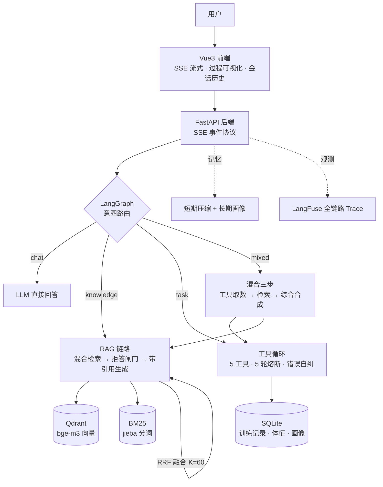
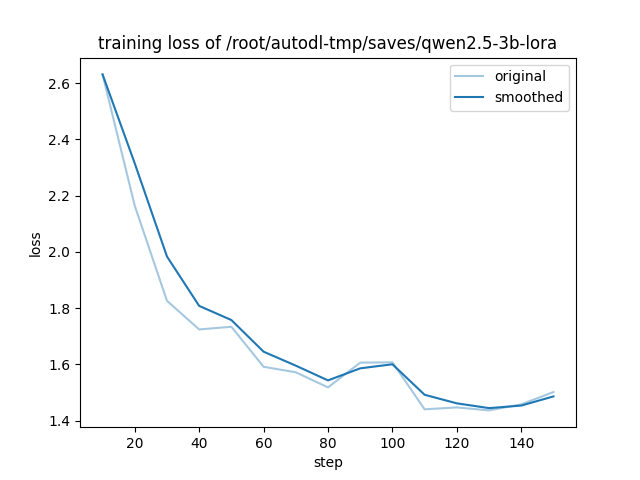

# FitPilot · AI 健身私教

> RAG + 多工具 Agent 的智能健身私教系统 —— 会说"我不知道"、记得住你、能查会算、过程透明

FitPilot 不是"套壳问答机"：它有**可溯源的知识问答**（混合检索 + 双防线拒答）、**能动手的工具层**（手写 function calling，记录训练/查营养/追踪体征）、**认识用户的长期画像**（"我 180 斤"自动换算入库、"降到 120 斤"覆盖更新）、以及**一套完整的评测体系**（248 题 + 同基座 LoRA 三组对比实验）。

## 核心指标

| 实验 | 结果 |
|---|---|
| 混合检索 Hit@1（248 题评测集） | **hybrid 83.6%** > vector 82.1% > bm25 78.1% |
| 拒答召回（知识库外问题敢说不知道） | **100%**（双防线：检索闸门 + 生成层标记） |
| Agent 混合题（一句话里工具+知识） | **15/15 满分**，任务题 10/12 |
| LoRA 三组对比（Qwen2.5-3B 同基座） | **LoRA+RAG 96.9%** > 基座 87.9% > LoRA 66.2% |

> 完整数据与解读见 [docs/eval-report.md](docs/eval-report.md)（检索对比）与 [docs/ft-compare-report.md](docs/ft-compare-report.md)（微调实验）。

## 架构



**关键设计**：

- **模型是可插拔组件**——生成通道整体可切换（改两个环境变量即可从智谱 GLM 切到自托管 vLLM），裁判模型与被测模型分通道，实验已验证
- **分级知识源**——本地知识库优先；联网搜索（`search_web` 工具）只兜底健身相关的时效性问题，回答显式标注"来自网络检索"并附来源链接；知识库外问题照常拒答，联网不稀释拒答语义
- **双防线拒答**——检索层闸门（top1 向量分 < 0.61 直接拒答，阈值按 embedding 模型标定）+ 生成层结构化标记 `【无法回答】`，拒答召回 100% 而知识题误拒 < 9%
- **混合题三步链路**——工具只负责取数据，知识由 RAG 供给，最后 LLM 合成；避免工具结果污染知识生成的"各自专业"问题
- **手写 function calling 循环**——不用框架代办：schema 声明、多轮终止、工具错误转模型可读信息促其自纠、超限熔断

## 它能做什么

| 你说 | 它做 |
|---|---|
| "新手一周练几次合适？" | 混合检索知识库，带引用回答，出处精确到章节 |
| "今天深蹲 4 组×8，60 公斤" | function calling 解析入库，自动推算部位与容量 |
| "两个鸡蛋多少蛋白质？" | 查营养库按份量估算（区分"每100克/整份"口径） |
| "我体重 180 斤" | 自动换算 90kg 写入长期画像；说"降到 120 斤"会覆盖更新 |
| "Python 爬虫怎么写？" | 老实拒答——知识边界是机制不是玄学 |
| "2026 年有什么新的增肌理念？" | mixed 路由 → 联网搜索 → 答案标注"来自网络"并附来源链接 |
| "我这周练了 3 次腿，量够吗？深蹲后腰疼正常吗" | mixed 路由：先查你的训练记录，再检索知识，一条回答综合 |

## 评测体系

- **评测集 248 题**：knowledge 201 + reject 20（考幻觉抑制）+ task 12 + mixed 15；双语表头 CSV，含多可接受出处口径
- **工程韧性**：断点续跑（逐题落盘）、单题异常隔离、并发可配（embedding 限流预算）、强裁判模型关思考
- **LoRA 三组对比实验**（详见 [docs/ft-compare-report.md](docs/ft-compare-report.md)）：
  - SFT 语料 791 条由知识库蒸馏（6 种问法变体），LoRA rank16 仅训 **0.96% 参数**，RTX 4080 SUPER 上 **3.6 分钟**完成训练
  - vLLM 单进程双模型名（基座 / LoRA）保证三组推理参数完全一致
  - **结论：微调单独用反而降分且丢失拒答边界感（60%→10%），检索闸门才是机制性防线（100%）——微调塑风格，检索供事实**



> LoRA adapter（115MB）超出 git 单文件限制，见仓库 Release 下载，挂载到任意 Qwen2.5-3B-Instruct 基座即可复现。

## 快速开始

### 方式一：Docker 一键部署（推荐）

```bash
cp .env.example .env   # 填入 ZHIPU_API_KEY（EMBEDDING_*/LANGFUSE_* 可选）
docker compose up -d --build
# 打开 http://localhost:8090
```

Nginx 前端(8090) → FastAPI 后端 → Qdrant 向量库三服务编排；数据落宿主机 `./data` 卷；SSE 经 Nginx 反代透传（`proxy_buffering off`）。

### 方式二：本地开发

```bash
uv sync                                  # 需先 pip install uv
cp .env.example .env                     # 填入 ZHIPU_API_KEY
docker compose up -d qdrant              # 启动向量库
.venv/Scripts/python.exe scripts/smoke_test.py
.venv/Scripts/python.exe scripts/build_index.py   # 建索引（首次必须）
.venv/Scripts/python.exe scripts/run_server.py    # 后端 :8000
cd web && npm install && npm run dev               # 前端 :5174
```

### 复现微调实验

训练与服务配置在 `scripts/autodl/`（LLaMA-Factory yaml + vLLM 双模型脚本），语料生成 `scripts/gen_sft_data.py`，三组对比评测 `scripts/eval_finetune.py`（支持断点续跑 / 原位重判 / 分通道裁判）。单卡 24GB+ 显存即可复现。

## 技术栈

**后端** Python 3.12 · FastAPI · SSE · LangGraph · pydantic-settings · uv
**RAG** Qdrant · BAAI/bge-m3（硅基流动） · rank-bm25 + jieba · RRF 融合
**Agent** 手写 function calling 循环 · 5 工具 · LangGraph StateGraph 四路意图路由
**记忆** 短期压缩摘要 + 长期画像（触发词/量纲正则 → LLM 抽取 → SQLite）
**微调** LLaMA-Factory · Qwen2.5-3B-Instruct · vLLM（LoRA 热挂载）
**前端** Vue3 · Vite · Element Plus · SSE 流式渲染
**观测** LangFuse v5（OTel 架构）
**部署** Docker · Nginx

## 项目结构

```
app/
├── core/       # 配置(模型可插拔) · LLM/Embedding双通道客户端 · LangFuse观测
├── rag/        # 切块(uuid5稳定ID) · 混合检索 · 拒答闸门 · 带引用生成
├── agent/      # LangGraph路由 · 工具循环(熔断) · 5个工具
├── memory/     # 短期压缩 + 长期画像抽取
└── api/        # FastAPI · SSE事件协议 · 会话历史
data/
├── corpus/     # 知识库语料 31篇/183章
├── sft/        # 微调语料 791条
└── eval/       # 评测集248题 + 逐题明细
scripts/        # 建索引/评测/微调/部署脚本（autodl/ 为云端训练配置）
docs/           # 评测报告×3 · 微调对比 · badcase · 开发日志 · 观测统计
```

## 文档

- [评测报告：三路检索对比](docs/eval-report.md) —— 248 题，结论随 embedding 模型变化的方法论教训
- [微调三组对比](docs/ft-compare-report.md) —— LoRA+RAG 96.9% 的完整实验记录
- [Badcase 分析](docs/badcase-report.md) —— 误拒/漏检/生成质量分类归因
- [开发日志](docs/dev-log.md) —— 7 条踩坑记录（评测四连败、429 静默吞错等）
- [LangFuse 观测统计](docs/observability-stats.md)

## Roadmap

- [x] 联网搜索工具（分级知识源：本地知识库优先，联网只兜底时效性健身问题，回答标注来源层级）
- [ ] MCP 工具接入（现有 6 工具暴露为 MCP server）
- [ ] 检索重排（cross-encoder rerank）与查询改写
- [ ] 评测集扩充与多裁判一致性校验

## 开发里程碑

8 步完整开发路线全部完成（2026-10-28 ~ 10-31）：检索链路 → 带引用生成与首轮评测 → Agent 工具层 → LangGraph 路由与双层记忆 → FastAPI+SSE+Vue 前端 → LangFuse 观测与 Docker 部署 → 248 题全量评测与 LoRA 对比实验 → 开源发布。每一步的踩坑与排查过程记录在[开发日志](docs/dev-log.md)。
